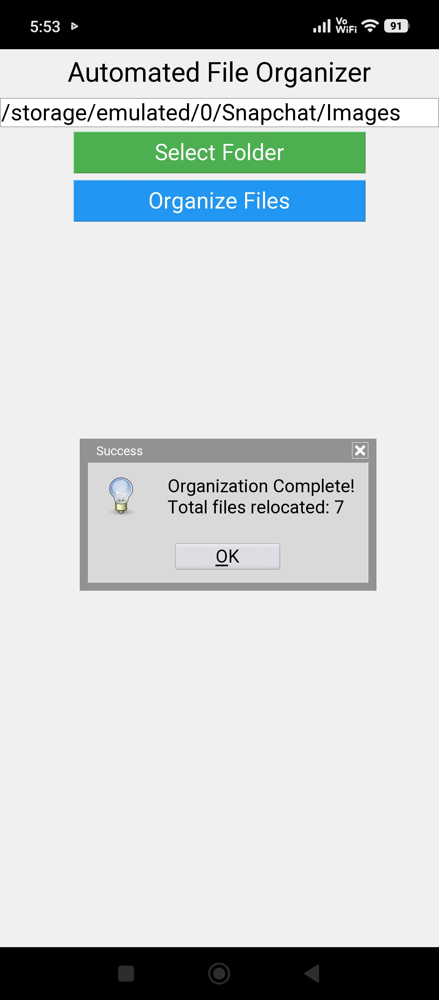

# Python Projects: Hangman & File Organizer 🚀

Welcome to my Python portfolio! This repository features two practical projects built using Python: a classic word-guessing game and an automated file management utility with both CLI and GUI interfaces.

---

##Projects Included

### 1. Hangman Game 🎮
* **Description:** A classic command-line word-guessing game built in Python. Players must guess the hidden word letter by letter before running out of attempts.
* **Key Features:**
  * Interactive text-based gameplay.
  * Input validation and attempt tracking.
  * Clean and modular Python logic.

### 2. Automated File Organizer & Cleanup Utility 📁
* **Description:** An autonomous desktop automation utility designed to clean up cluttered directories (such as Downloads) by inspecting file extensions and organizing them into category subfolders (`/Documents`, `/Images`, `/Videos`, `/Archives`, `/Code`).
* **Recommended Tools Used:** `os`, `shutil`, `pathlib`, `tkinter`.
* **Key Features:**
  * **Dual Interface:** Supports both command-line execution and a user-friendly **Graphical User Interface (GUI)** built with Tkinter.
  * **Fast Scanning:** Uses `os.scandir()` to efficiently scan directory entries.
  * **Safe Relocation:** Relocates files safely using `shutil.move()`.
  * **Error Handling:** Implements `try-except` blocks to handle permission errors and naming collisions gracefully.

---

## 🛠️ Requirements & Technologies
* **Language:** Python 3.x
* **Built-in Libraries:** `os`, `shutil`, `pathlib`, `tkinter`
* **Environment:** Compatible with **Pydroid 3** on mobile and standard Python environments on desktop.

---

## 🚀 How to Run
1. Clone or download this repository.
2. Open the script in your Python environment (e.g., Pydroid 3).
     ```

---
## 📸 Project Outputs

### Hangman Game Output


### File Organizer GUI Output


⭐ *Feel free to explore the code and share your feedback!*

