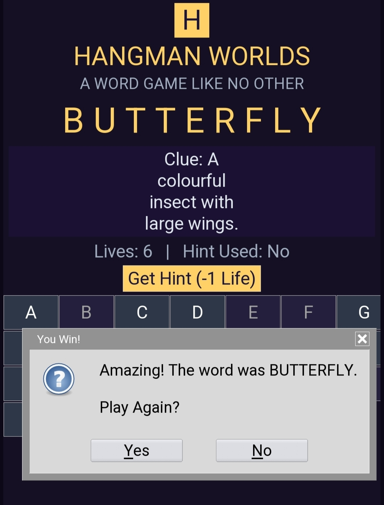
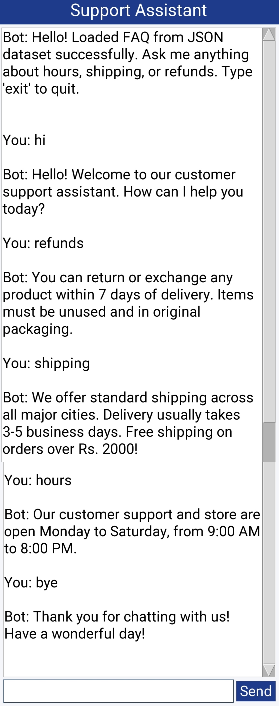

# Python Projects: Hangman, File Organizer & Chatbot 🚀

Welcome to my Python portfolio! This repository features three practical projects built using Python: a classic word-guessing game, an automated file management utility, and a GUI-based customer support chatbot.

## Projects Included

### 1. Hangman Game 🎮
* **Description:** A classic command-line word-guessing game built in Python. Players must guess the hidden word letter by letter before running out of attempts.
* **Key Features:**
  * Interactive text-based gameplay.
  * Input validation and attempt tracking.
  * Clean and modular Python logic.

### 2. Automated File Organizer & Cleanup Utility 📁
* **Description:** An autonomous desktop automation utility designed to clean up cluttered directories (such as Downloads) by inspecting file extensions and organizing them into category subfolders (`/Documents`, `/Images`, `/Videos`, `/Archives`, `/Code`).
* **Recommended Tools Used:** `os`, `shutil`, `pathlib`, `tkinter`.
* **Key Features:**
  * **Dual Interface:** Supports both command-line execution and a user-friendly Graphical User Interface (GUI) built with Tkinter.
  * **Fast Scanning:** Uses `os.scandir()` to efficiently scan directory entries.
  * **Safe Relocation:** Relocates files safely using `shutil.move()`.
  * **Error Handling:** Implements try-except blocks to handle permission errors and naming collisions gracefully.

### 3. Rule-Based Customer Support Chatbot 🤖
* **Description:** A graphical user interface (GUI) chatbot built using Python, Tkinter, Regular Expressions (`re`), and an external `faq.json` dataset to handle customer queries dynamically.
* **Key Features:**
  * **GUI Support:** Clean and responsive interface styled for user interaction.
  * **External JSON Dataset:** Dynamically loads FAQs, patterns, and responses from `faq.json`.
  * **Regex Pattern Matching:** Utilizes Python's `re` module for intelligent query recognition.
  * **Smooth Flow:** Handles greetings, business hours, shipping, refunds, and clean exit commands.

---

## 🛠️ Requirements & Technologies
* **Language:** Python 3.x
* **Libraries Used:** `os`, `shutil`, `pathlib`, `tkinter`, `json`, `re`
* **Environment:** Compatible with Pydroid 3 on mobile and standard Python environments on desktop.

---

## 🚀 How to Run
1. Clone or download this repository.
2. Open the respective script in your Python environment (e.g., Pydroid 3).

---

## 📸 Project Outputs

### 1. Hangman Game Output

### 2. File Organizer GUI Output

### 3. Chatbot Execution Till End
#### Initial Interaction & Core Queries

---

⭐ Feel free to explore the code and share your feedback!
